# Sailboat lines from published drawings

Realistic sailing-vessel outlines, traced by hand from a published sail-plan
drawing and lofted into 3D. The trace is the data; everything else is
regenerated from it:

```bash
node scripts/sailboat-lines.mjs
```

| Boat                          | Trace                                      | Profile                                        | Plan                                        | Body plan                                       | Loft                                        |
| ----------------------------- | ------------------------------------------ | ---------------------------------------------- | ------------------------------------------- | ----------------------------------------------- | ------------------------------------------- |
| Hans Christian 38T            | [json](hans-christian-38t.json)            | 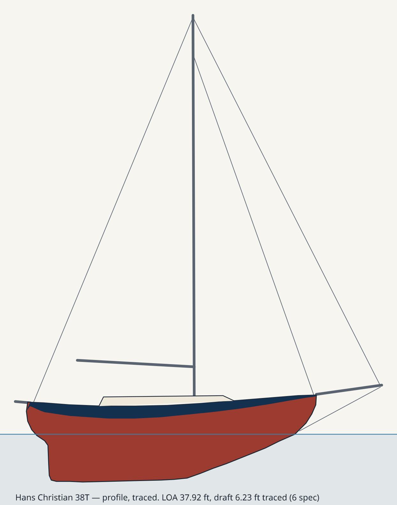            | 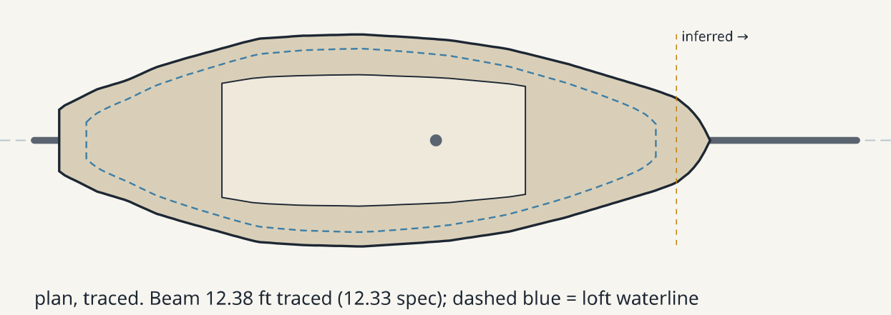            | 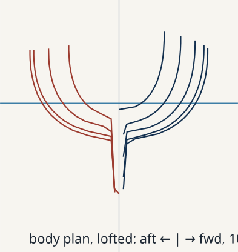            | 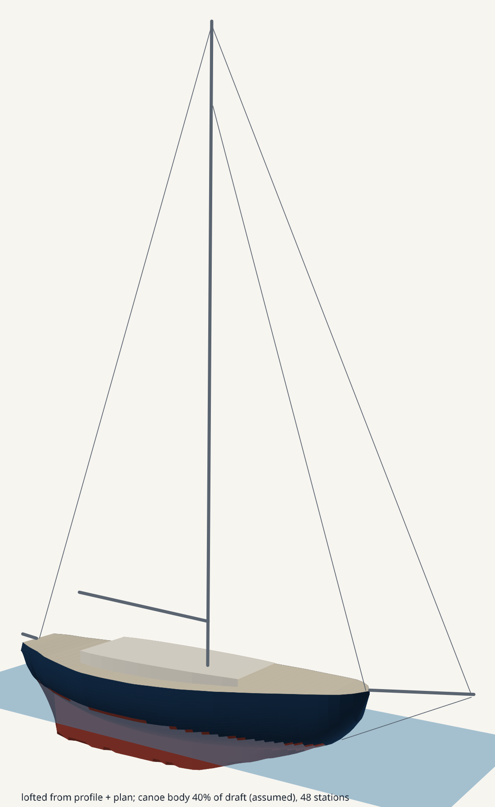            |
| Com-Pac 16                    | [json](com-pac-16.json)                    | 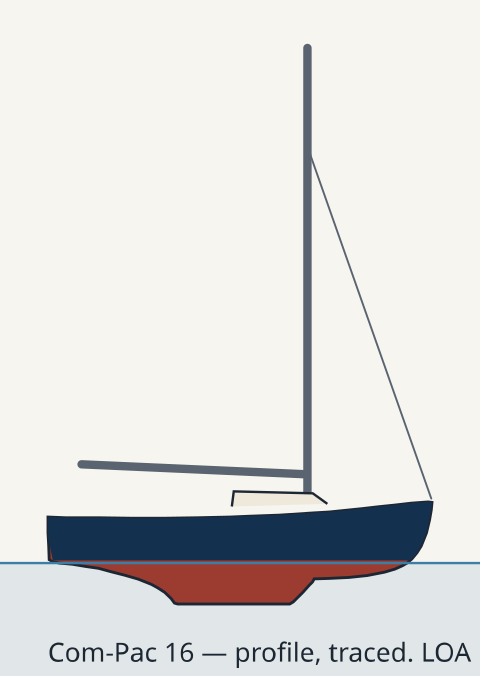                    | 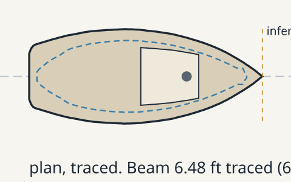                    | 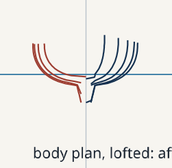                    | 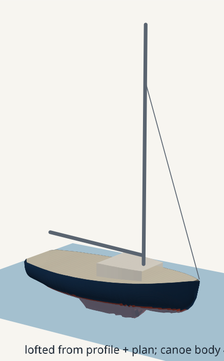                    |
| Catalina 30 Mk II             | [json](catalina-30-mkii.json)              | 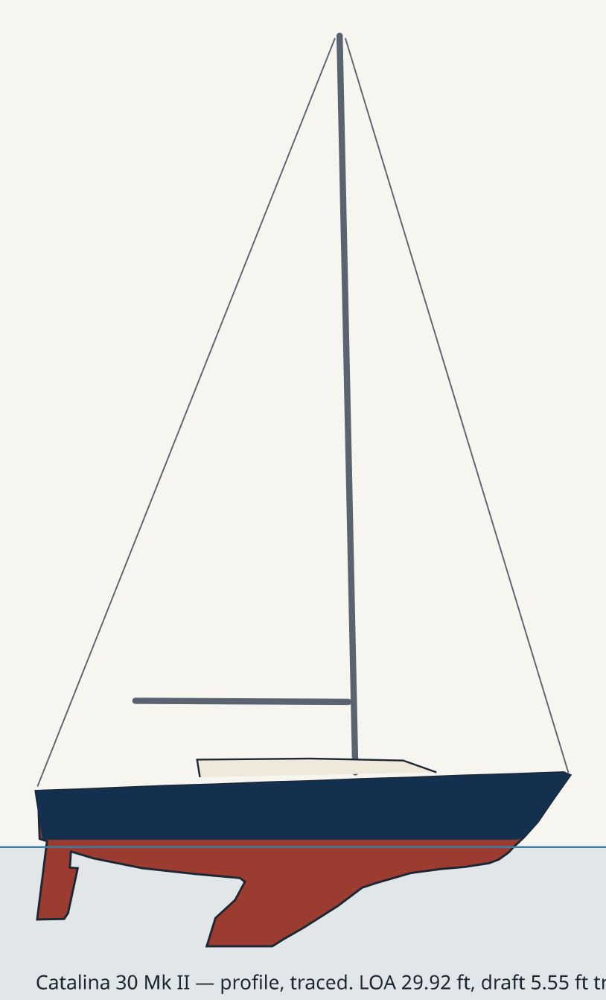              | 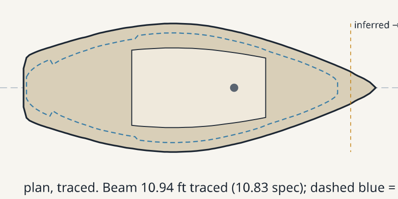              | 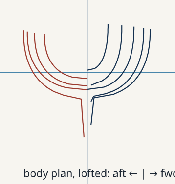              | 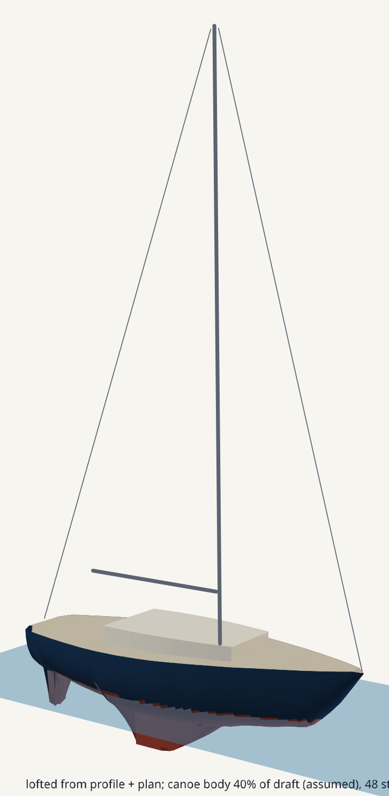              |
| Westsail 32                   | [json](westsail-32.json)                   | 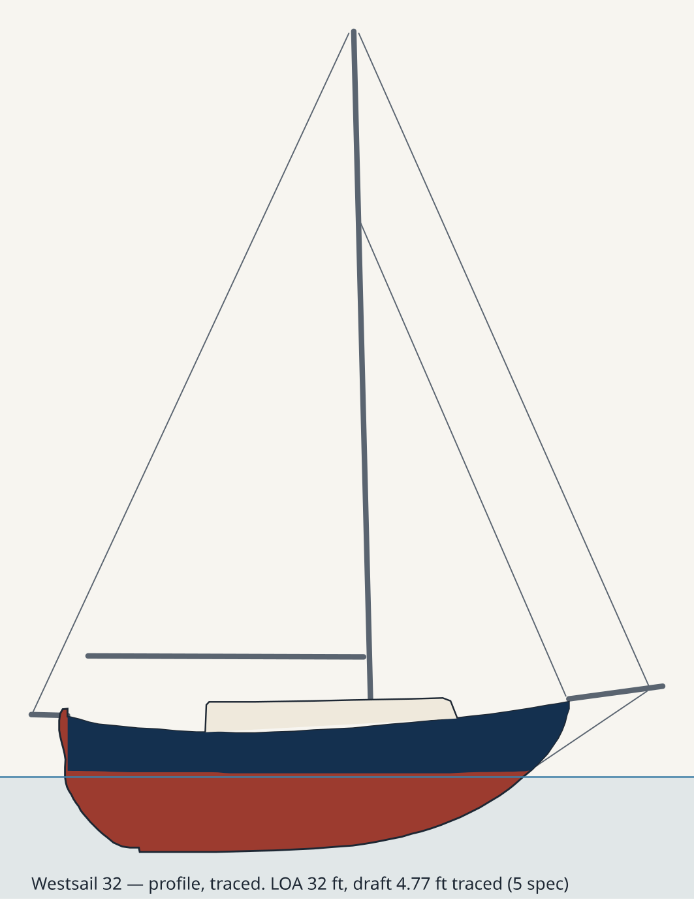                   | 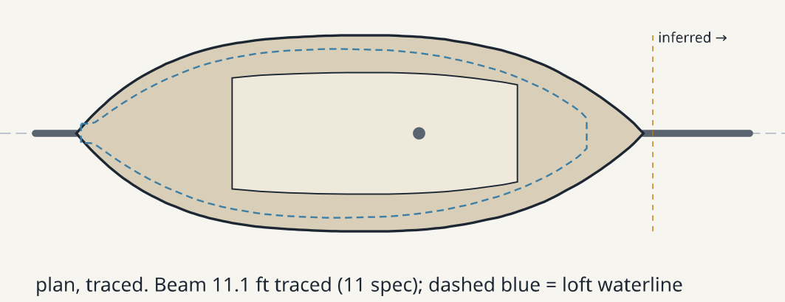                   | 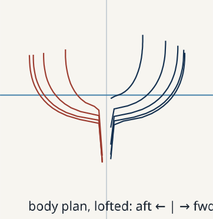                   | 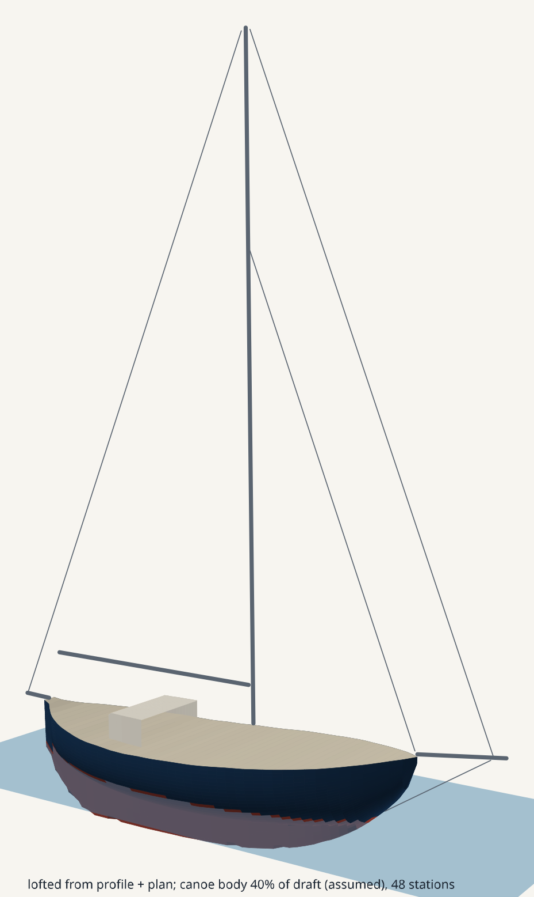                   |
| Cheoy Lee Clipper 48 schooner | [json](cheoy-lee-clipper-48-schooner.json) | 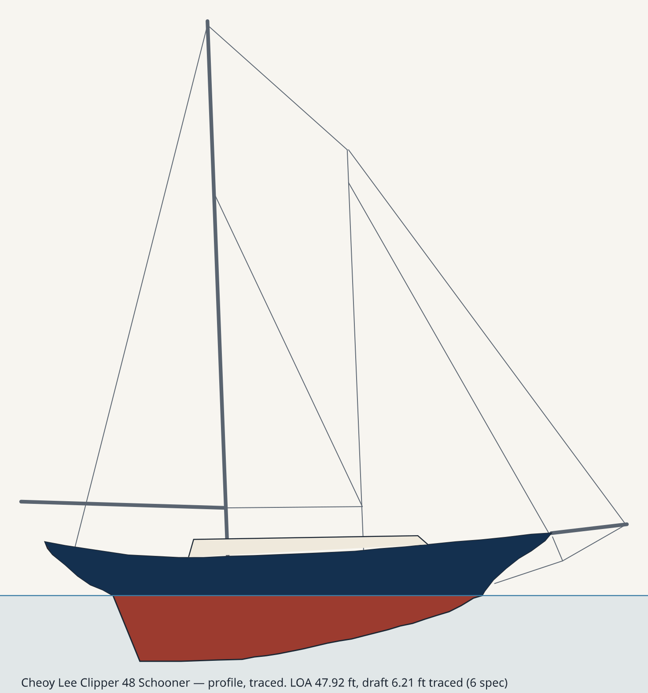 | 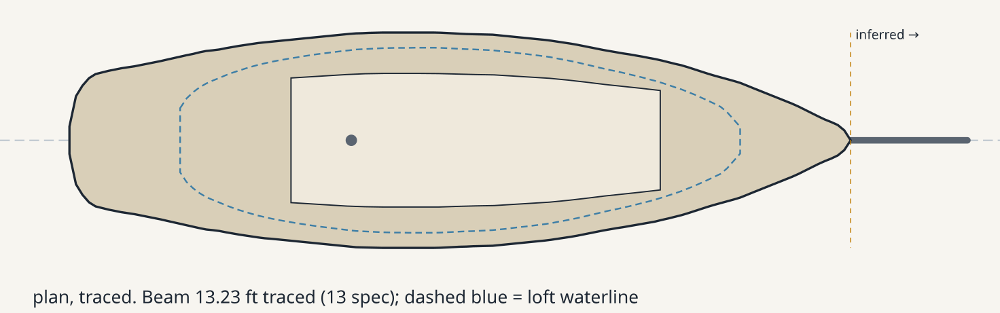 | 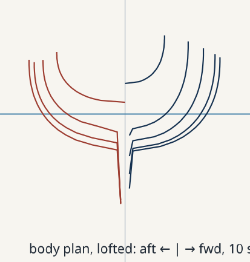 | 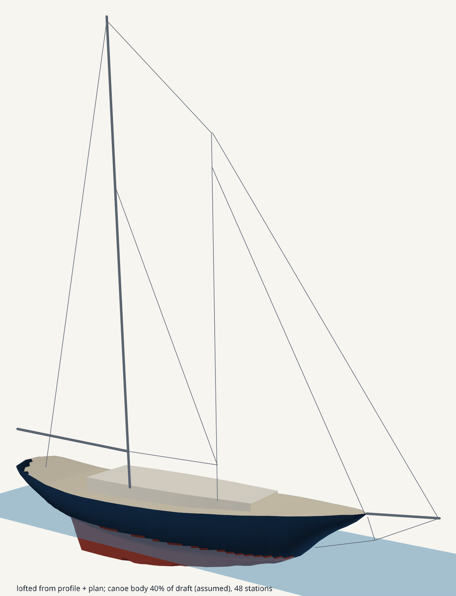 |

## Sources

| Boat                          | Spec page                                                          | Drawing                                                                                                                                                                                     |
| ----------------------------- | ------------------------------------------------------------------ | ------------------------------------------------------------------------------------------------------------------------------------------------------------------------------------------- |
| Hans Christian 38T            | <https://sailboatdata.com/sailboat/hans-christian-38t/>            | <https://sailboatdata.com/wp-content/uploads/2023/03/hans_christian_38_drawing.jpg>                                                                                                         |
| Com-Pac 16                    | <https://sailboatdata.com/sailboat/com-pac-16/>                    | <https://sailboatdata.com/wp-content/uploads/2023/03/ComPac_16_drawing.jpeg>                                                                                                                |
| Catalina 30 Mk II             | <https://sailboatdata.com/sailboat/catalina-30-mkii/>              | <https://sailboatdata.com/wp-content/uploads/2023/03/catalina_30_mkii_drawing.jpg>                                                                                                          |
| Westsail 32                   | <https://sailboatdata.com/sailboat/westsail-32/>                   | <https://sailboatdata.com/wp-content/uploads/2023/03/westsail_32_drawing-1.jpg>                                                                                                             |
| Cheoy Lee Clipper 48 schooner | <https://sailboatdata.com/sailboat/clipper-48-schooner-cheoy-lee/> | <https://sailboatdata.com/wp-content/uploads/2023/03/cheoy_lee_clipper_48_sch_drawing.jpg>, keel and plan from <https://sailboatdata.com/wp-content/uploads/2023/03/clipper_48_drawing.jpg> |

The drawings are not committed; the json records each URL and the size it had.
sailboatdata.com sits behind Cloudflare: a plain `curl` gets a challenge page.
A browser user agent gets the file, and the spec page then comes back as a
printable PDF:

```bash
curl -sSL --compressed -A "Mozilla/5.0 (Windows NT 10.0; Win64; x64) AppleWebKit/537.36 (KHTML, like Gecko) Chrome/130.0 Safari/537.36" -o drawing.jpg "<drawing url>"
```

## Method

1. **Read the drawing's layout.** sailboatdata drawings put an accommodation
   plan above a sail-plan profile, on one shared x scale. Check it: a point
   both views draw (the bowsprit tip) should have the same x in each.
2. **Calibrate on the profile.** Transom top to stem head is the published
   LOA, which excludes the bowsprit and any stern spar. Where something hangs
   aft of the transom in the outline (an outboard rudder), `profile.loaFromX`
   names the two ends. Check draft, LWL and
   beam against the spec page; they should agree within a few percent.
3. **Trace by hand** off gridded enlargements of the scan, in source pixels:
   the profile outline (sheer, stem, forefoot, keel, rudder, counter), the
   boot-top, the coachroof, the rig as straight lines, and the plan's
   half-breadths about its centreline. A column scan for dark pixels helps
   along clean stretches; rigging crossing the outline defeats it, so the
   reading is by eye.
4. **Write down what is not traced.** Anything inferred goes in the json's
   `notes`, and the plan marks where inference starts.
5. **Loft.** With no lines plan, each section is a rounded canoe body (deck
   half-breadth from the plan, sheer from the profile) down to an assumed
   depth, 40% of draft at its deepest, with the keel below it as a fin
   following the traced profile. The body plan shows the result; that
   assumption is the first thing to change if it looks wrong.

## Hans Christian 38T findings

| Quantity                            | Traced   | Published                                             |
| ----------------------------------- | -------- | ----------------------------------------------------- |
| LOA (calibration)                   | 37.92 ft | 37.92 ft                                              |
| LWL                                 | 33.75 ft | 33.0 ft                                               |
| Beam                                | 12.38 ft | 12.33 ft                                              |
| Draft                               | 6.23 ft  | 6.0 ft                                                |
| Sparred length, boomkin to bowsprit | 47.9 ft  | about 47 ft, measured on hull _Symphony_ by her owner |

- The plan draws a boomkin aft of the transom; the profile does not (its
  backstay lands on the transom top). The boomkin is taken from the plan.
- Forward of the plan's x 455 the drawn outline runs straight on into the
  bowsprit platform; the deck's closure to the stem head is a guess.
- The rig is to scale: masthead about 55 ft above the waterline, 2.3 hull
  half-lengths. The profile drawings in `src/hulls.tsx` keep masts under one
  unit to fit their 440 x 240 viewBox, so this rig does not drop into that
  frame unchanged.

## Range of sizes and forms

| Boat                          | LOA      | Form                                         | LWL traced / spec | Beam             | Draft          |
| ----------------------------- | -------- | -------------------------------------------- | ----------------- | ---------------- | -------------- |
| Com-Pac 16                    | 16.0 ft  | shoal keel, outboard rudder (not traced)     | 14.44 / 14.0 ft   | 6.48 / 6.0 ft    | 1.72 / 1.5 ft  |
| Catalina 30 Mk II             | 29.92 ft | fin keel, spade rudder                       | 25.3 / 25.0 ft    | 10.94 / 10.83 ft | 5.55 / 5.25 ft |
| Westsail 32                   | 32.0 ft  | double-ender, long keel, transom-hung rudder | 27.1 / 27.5 ft    | 11.1 / 11.0 ft   | 4.77 / 5.0 ft  |
| Hans Christian 38T            | 37.92 ft | long keel, cutter                            | 33.75 / 33.0 ft   | 12.38 / 12.33 ft | 6.23 / 6.0 ft  |
| Cheoy Lee Clipper 48 schooner | 47.92 ft | long keel, two masts                         | 34.74 / 34.0 ft   | 13.23 / 13.0 ft  | 6.21 / 6.0 ft  |

LWL here is the hull body's. The script's printout runs to the lowest point
of any section, so a rudder hung aft stretches it: Catalina 26.63 ft, Westsail
28.96 ft.

- **Com-Pac 16** reads 8% wide and 15% deep. The masthead height agrees with
  the spec within 2.3%, so the scale holds and the drawing itself is fuller
  than the spec sheet. The rudder hangs aft of the transom and is left out.
- **Catalina 30 Mk II** stands in for the Mk I, whose drawing stops at the
  waterline; it is the same hull with a new deck. Its keel is drawn about 6%
  deep, and the rig reads between the standard and tall rigs. Forward of plan
  x 524 the deck closure is a guess.
- **Westsail 32**: the outboard rudder is the outline's aft-most point, so
  `loaFromX` takes LOA from the sternpost head. The upper deck line is the
  bulwark caprail and is not the sheer. The plan is shifted from the profile
  and mapped onto it through the stern and bow points.
- **Cheoy Lee Clipper 48 schooner**: the schooner drawing stops at the
  waterline and has no plan, so keel, rudder and plan come from the ketch
  drawing of the same Luders hull. The script's spar list names only `mast`,
  so the foremast and staysail boom draw as wire. Neither the Thomas W.
  Lawson nor the schooner Wyoming has a sailboatdata page.
