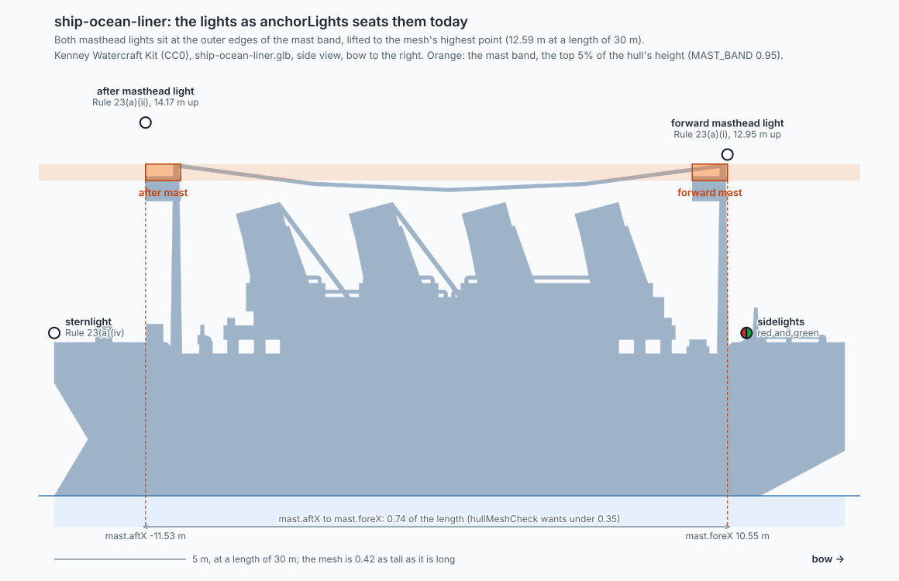
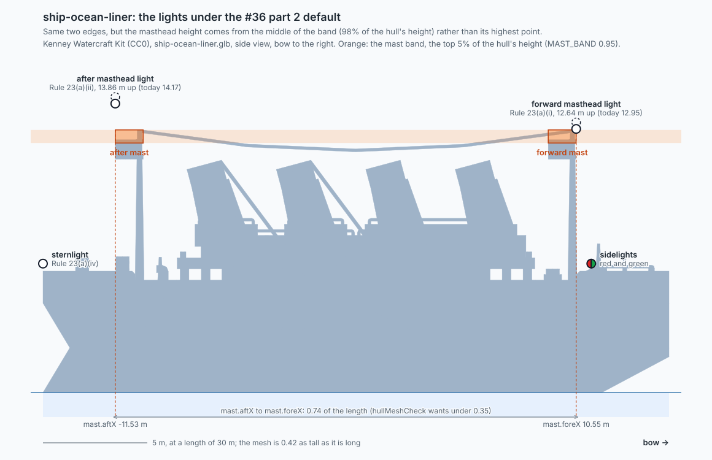

# ship-ocean-liner's masthead lights

Research for [#36](https://github.com/mark-brannan/nav-wright/issues/36) part 2. No change to `src/`.

## Finding

`ship-ocean-liner` is not mastless. The Kenney mesh has **two masts**, one near each end of the superstructure, joined at their tops by an aerial wire. The mast band (the top 5% of the hull's height) catches only those two mast tops, and `mast.aftX` to `mast.foreX` is 0.74 of the length because the masts are 20 m apart, not because a deck is long and flat. `anchorLights` already seats the forward masthead light on the forward mast and the after one on the after mast.

So part 2's premise ("its highest structure genuinely is a long flat deck") is wrong for this hull, and the default logged on #36 changes the picture by 0.31 m on a 30 m hull.

## What the mesh is

Side view of `ship-ocean-liner.glb` at a length of 30 m, bow to the right, with the lights as `anchorLights` seats them today (`MAST_BAND` 0.95, [#46](https://github.com/mark-brannan/nav-wright/pull/46)):



| Fact | Value | Source |
|---|---|---|
| Mesh | 4,366 vertices, 2,796 triangles, 0.42 as tall as long | measured |
| Masts | after mast x -11.53 to -10.20 m, forward mast x 9.21 to 10.55 m; both tips 12.59 m | measured, `bandClusters` in the test |
| Band | two separate clusters, 19.4 m apart (0.65 L) | measured |
| Heading | bow at +Z of the glTF | see Limits |

## What the default changes

The default logged on #36 keeps both edges and takes the height "from the band's height range rather than the mesh extremes". The mesh's highest point is the mast tips, so the band's range is 11.96 to 12.59 m. The ruling does not say where in that range; I took the middle. All three readings are within 0.63 m (5% of the hull's height) of each other.

| Reading of "from the band" | `mast.top` | Forward light | After light |
|---|---|---|---|
| Highest point (today) | 12.59 m | 12.95 m | 14.17 m |
| Middle of the range (drawn below) | 12.28 m | 12.64 m | 13.86 m |
| Floor of the range | 11.96 m | 12.32 m | 13.54 m |

The lights are 0.36 m above `mast.top` (`lightRadius`); the after light is a further 1.2 m up because `placeLights` puts it 0.1 higher than the forward one in drawing units (Rule 23(a)(ii): abaft and higher).



On the floor reading the forward light sits 0.27 m below the mast tip; the middle reading keeps it above the tip.

## The three questions, plainly

**How can a mastless hull have a mastlight?** This one is not mastless. And the rule does not ask for a mast: Rule 21(a) defines the light by position, "a white light placed over the fore and aft centerline of the vessel showing an unbroken light over an arc of the horizon of 225 degrees". "Mast" is in the name for history. A hull with no mast still carries it, on whatever structure stands on the centreline.

**Why would we think it needs one?** Rule 23(a): a power-driven vessel underway exhibits (i) "a masthead light forward" and (ii) "a second masthead light abaft of and higher than the forward one", unless under 50 m. A liner underway under power is over 50 m, so two. Annex I 2(a)(i) puts the forward one at least 6 m above the hull (more if the beam exceeds 6 m, never required above 12 m) and 2(a)(ii) puts the after one at least 4.5 m higher; 2(f)(i) wants them "above and clear of all other lights and obstructions". The renderer needs two seats, high and on the centreline. This mesh has two masts to give them.

**What do bands, edges and heights have to do with it?** The renderer is handed a mesh and is not told where its mast is, so it guesses: the tallest 5% of the hull is "the mast" (the band). On a tug that is the funnel, one lump. The forward edge of the lump is where the forward light goes, the aft edge is where the after light goes, and "height" is how far up. A narrow band means one mast. `hullMeshCheck` calls a band wider than 0.35 of the length "not a mast", which is true of one long deckhouse and also true of any ship with a mast at each end.

Rule texts are as held in the colregs data this repo's engine reads (`intl@2016` en-US, and `geometry.json` for Annex I). I did not re-check them against the IMO original.

## What this means for part 2

Across the kit's boats and ships (bow at +Z, `MAST_BAND` 0.95), nine have a band 0.35 L or wider: `boat-house-b`, `boat-house-d`, `boat-row-small`, `boat-speed-c`, `boat-speed-f`, `boat-speed-g`, `boat-tow-a`, `ship-ocean-liner-small` and `ship-ocean-liner`. All nine split into two or more separate clusters (a gap over a tenth of the length starts a new one). No hull has one wide cluster, which is what a deckhouse fallback would serve; the widest single cluster is 0.24 L (`boat-tug-b`). Measured with a one-off extension of this test over all 46 files, not committed.

What the liner needs is not a fallback for a missing mast but to be read as having two:

- the forward light on the forward cluster and the after light on the after cluster, at each cluster's own height and centre rather than its outer edge and the mesh's top;
- `hullMeshCheck`'s mast test counting clusters instead of measuring one span, so a two-masted hull stops failing it ([#44](https://github.com/mark-brannan/nav-wright/issues/44) expects the liner to fail "until #36 part 2").

Both are code changes the research does not make.

## Draft re-ask

> **Decide:** should #36 part 2 (a deckhouse fallback for "mastless" hulls) be dropped, now that `ship-ocean-liner` turns out to have two masts?
>
> The picture is `docs/research/ship-ocean-liner-masthead-now.svg`. The band is two mast tops 20 m apart; the code already puts the forward light on the forward mast and the after light on the after mast. The default moves each light 0.31 m on a 30 m hull. All nine wide-band hulls in the Kenney kit are several masts or posts, none a flat deck.
>
> | Answer | Cost |
> |---|---|
> | Drop part 2, no code change (recommended) | Nothing in `src/` moves. The harness's mast test becomes a cluster count, which is toil. |
> | Take the logged default | One small change. Lights drop 0.31 m; the rationale stays wrong for this hull. |
> | Seat each masthead light on its own mast | A new seat rule: forward light on the forward cluster, after light on the after one. The only option that matches how this hull is built. |

## Limits

- **Heading.** The hull is nearly symmetric in plan: `hullMeshCheck` scores the bow at 0.75 either way and keeps the first heading it tries. I took the bow at +Z because every other ship and boat in the kit tapers toward +Z (measured), and because this hull's keel rises 3.2 m (at a length of 30 m) toward +Z, a cut-away forefoot, while the -Z end runs out square. The test asserts the second. Flipped, the masthead lights move about 1 m along the length and the sidelights and sternlight about 0.3 m in height.
- **Scale.** Everything is at a length of 30 m; the mesh is a cartoon (0.42 as tall as long), so the metre figures are ratios, not a real liner's.
- **Duplicated code.** The loader and frame code in the test is `hullMeshCheck.test.ts`'s, narrowed to one mesh, because a test file cannot be imported without running its suite.

## Reproducing

```
curl -LO https://kenney.nl/media/pages/assets/watercraft-kit/a335cfed49-1713519620/kenney_watercraft-pack.zip
unzip kenney_watercraft-pack.zip -d kit
HULL_MESH_DIR="kit/Models/GLB format" npx vitest run test/oceanLinerRender.test.ts
```

Rewrites both SVGs and fails if the band stops being two masts, if the heading evidence flips, or if the default stops being a pure height change. About 1 s. Skipped without `HULL_MESH_DIR`.
